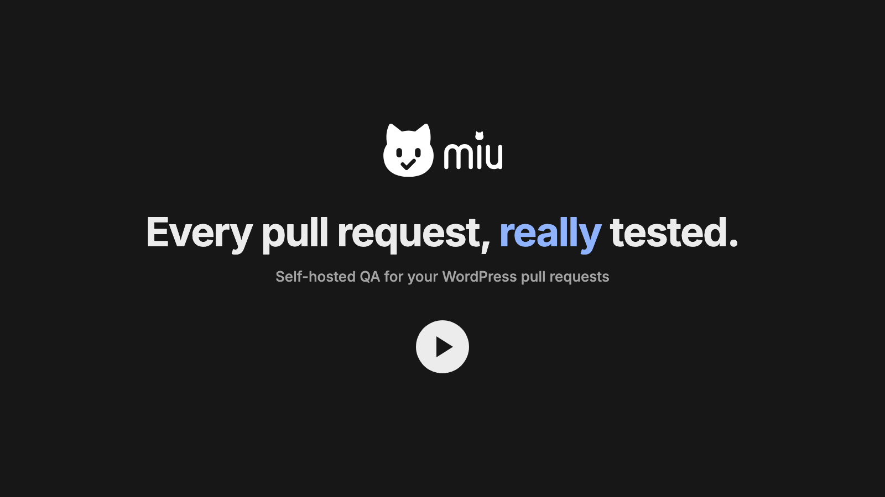
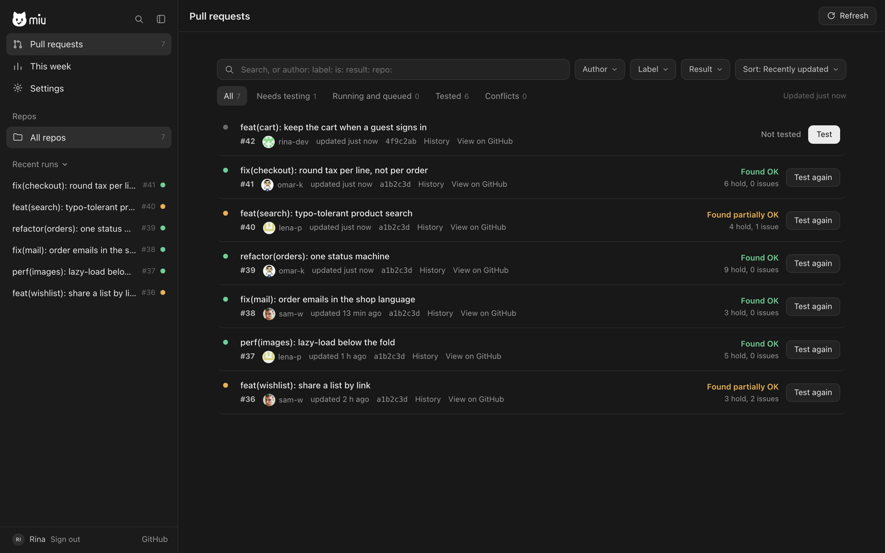
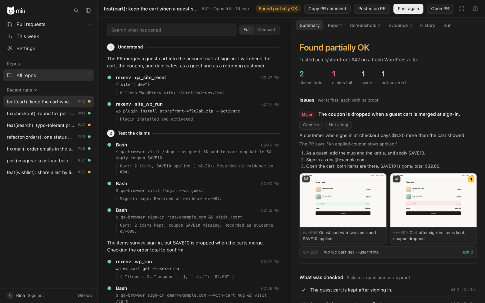
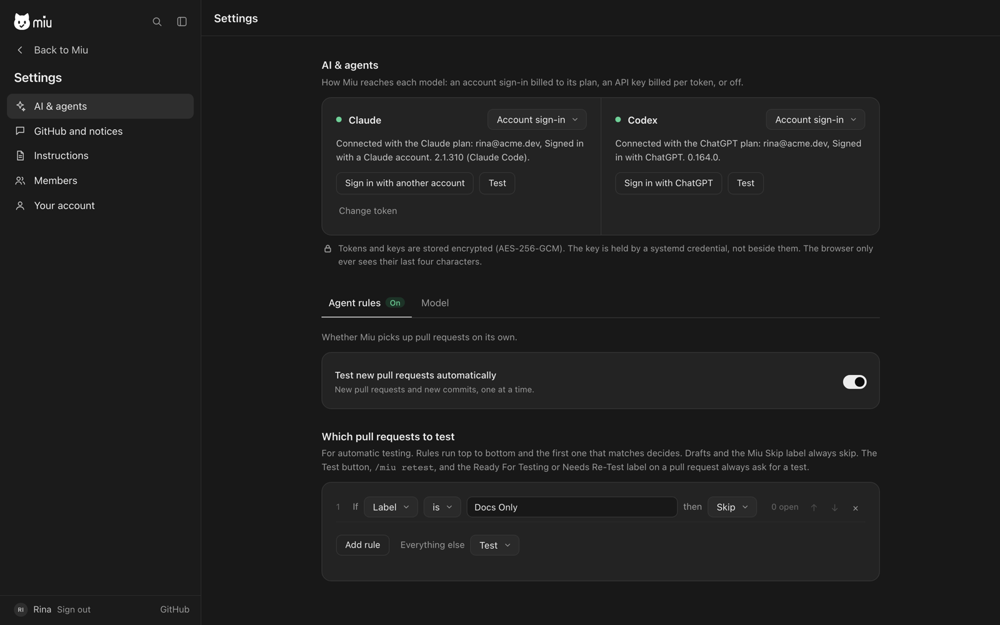

<h1>
  <picture>
    <source media="(prefers-color-scheme: dark)" srcset="assets/brand/miu-logo-big-white.svg">
    
  </picture>
</h1>

**Miu tests your WordPress plugin's pull requests on a real site, and posts the result on the pull request.**

[](https://res.cloudinary.com/ehtetpi9/video/upload/v1793454474/261031_194747_miu-intro-v8.mp4)

## What it does

1. You open a pull request.
2. Miu starts two WordPress sites: one with your base branch, one with the pull request.
3. An AI agent (Claude or GPT) checks every claim in the pull request on both sites. It saves screenshots, HTTP responses and command output as proof.
4. Miu posts the verdict on the pull request: **Found OK**, **Found partially OK** or **Found NOT OK**, with the full report behind a link.

It runs on your own server, with your own AI account. Nothing passes through us.







## Install

You need a server with Ubuntu 24.04 and 4 GB of memory. Run:

```sh
curl -fsSL https://raw.githubusercontent.com/akashmdiu/miu/main/install.sh | sudo bash -s -- --domain miu.example.com
```

Point the domain at the server first. Then open it in a browser and:

1. **Make your account** with the setup code the installer printed.
2. **Connect GitHub.** Click **GitHub** at the bottom of the sidebar, then **Create the App on GitHub**. This makes your own Miu bot on GitHub. Install it on your plugin's repositories.
3. **Add a repository.** On the same page, click **Make a profile** next to your plugin.
4. **Connect the AI.** In **Settings → AI & agents**, sign in with Claude or ChatGPT.

That's all. Miu tests the next pull request you open. To update Miu later, run the same command again.

## Change how it tests

Everything is in the dashboard; there are no files to edit.

- **Your product's rules** ("Pro features fail closed without a licence"): Settings → Instructions → Product notes.
- **How a repository is tested** (branch, test commands): the GitHub page → Edit.
- **Which pull requests to test**: Settings → AI & agents → Agent rules.

## Where your data lives

On your server only, as files. The code under test goes to GitHub and to the AI service you chose, and nowhere else. Passwords are stored as hashes. AI and GitHub tokens are encrypted with a key that only this server can open. The AI agent runs as its own Linux account, so it cannot read any of them.

## More

- [Install in detail](docs/install.md): what the installer changes, updating, removing
- [Profiles](docs/profiles.md): every setting for a repository
- [Security](docs/security.md): sign-in, roles, and how secrets are kept
- [How a test is done](docs/methodology.md): the method the agent follows

## Licence

[MIT](LICENSE)
